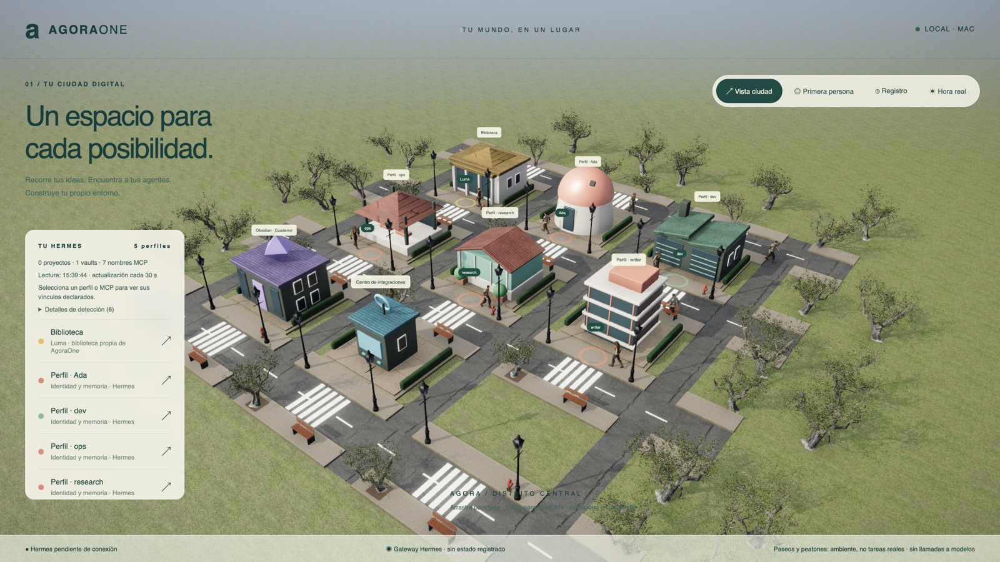
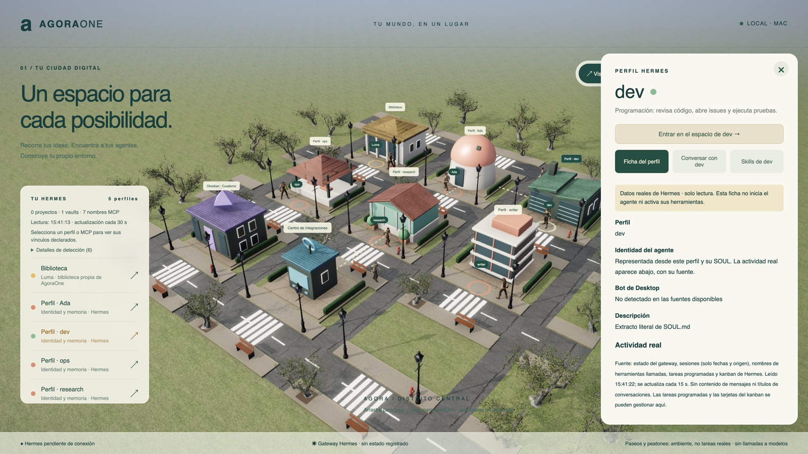

# AgoraOne

**Tu instalación local de [Hermes](https://github.com/NousResearch/hermes-agent) convertida en una ciudad 3D que puedes recorrer, entender y gestionar.**



<sub>Capturas hechas sobre una instalación de ejemplo con perfiles, MCP y notas ficticios.</sub>

## Qué es y para qué sirve

Cuando usas Hermes con varios perfiles (un asistente principal, uno para programar, otro para investigar…), toda su información vive repartida en carpetas: personalidad, memoria, servidores MCP, skills, tareas programadas, tableros kanban, registros de actividad. AgoraOne lo lee y lo convierte en un lugar:

- **Cada perfil es un edificio** con su propio interior. Entras y ves su identidad, su memoria, sus skills, sus tareas y lo que ha hecho últimamente.
- **Puedes hablar con cada perfil** usando su propio agente, sus herramientas y su memoria, y aprobar una a una las acciones que cambien algo.
- **Tus vaults de Obsidian son bibliotecas**: las carpetas son estanterías y cada nota se abre como un libro.
- **Los servidores MCP** de todos tus perfiles se reúnen en un centro de integraciones.

Sirve para tener una vista de conjunto de tus agentes, revisar y corregir lo que saben de ti, y gestionar su trabajo sin abrir archivos a mano ni usar la terminal.



## Funciones

| Área | Qué puedes hacer |
| --- | --- |
| **Ciudad** | Se genera a partir de los perfiles detectados, con ciclo de día y noche según la hora real. Vista aérea o paseo en primera persona. |
| **Perfiles** | Ver y editar su personalidad (SOUL.md), su memoria (MEMORY.md) y lo que sabe de ti (USER.md), con confirmación y copia previa. |
| **Skills** | Ver, crear y editar las skills de cada perfil. Las líneas que parecen claves quedan ocultas. |
| **Tareas y kanban** | Pausar, ejecutar, editar, crear o archivar tareas programadas y tarjetas del tablero de cada perfil, con las funciones de Hermes. |
| **Actividad real** | Estado del gateway, conexiones y actividad de cada perfil, leídos de los registros de Hermes sin el contenido de los mensajes. |
| **Conversación** | Hablar con un perfil como lo haría su bot: su modelo, sus herramientas y su memoria. Cada acción que cambie algo espera a que pulses «Permitir». |
| **Centro de integraciones** | Los servidores MCP de todos los perfiles y su catálogo de herramientas. Puedes ejecutar una herramienta a mano tras revisar el JSON exacto. |
| **Obsidian** | Recorrer tus vaults como una librería, leer notas con formato y enlaces internos, buscar en el contenido, y editar o crear notas con un editor visual en vivo. |
| **Navegación** | Paleta de comandos con ⌘K para ir a cualquier lugar o acción, directorio agrupado con buscador (`/`) y avisos cuando un chat espera tu permiso. |
| **Biblioteca y Luma** | Importar TXT, Markdown, PDF y DOCX como copias privadas y consultarlas con Luma, una asistente sin herramientas. |

Los paseantes y el movimiento de la ciudad son decorativos: no representan tareas reales y no llaman a ningún modelo.

## Qué necesitas

- macOS o Linux con **Node.js 22.12 o superior**.
- **Hermes** instalado en `~/.hermes`. Si está en otra ruta, indícala con `AGORA_HERMES_HOME` y `AGORA_HERMES_PATH`.
- Para conversar con Luma, un **proveedor de inferencia compatible con OpenAI** (modelo, URL y clave). Los perfiles usan su propia configuración de Hermes.
- Opcional: **Obsidian**, para ver tus vaults. Se detectan solos.
- Un navegador con WebGL. La ciudad se ve mejor con aceleración gráfica.

## Puesta en marcha

```sh
git clone https://github.com/yosnap/agoraone.git
cd agoraone
cp .env.example .env   # completa AGORA_MODEL, AGORA_BASE_URL y AGORA_API_KEY
npm ci
npm run dev
```

Abre el enlace privado que muestra la terminal («Abre AgoraOne con este enlace…») o ejecuta `npm run open`. Solo hace falta la primera vez en cada navegador.

Más detalle en [docs/arranque.md](docs/arranque.md). La arquitectura está en [docs/arquitectura.md](docs/arquitectura.md).

## Privacidad y seguridad

AgoraOne está pensado para usarse en tu propio ordenador:

- El servidor escucha **solo en `127.0.0.1`**. Toda la API exige un token de acceso guardado en `.agora/access-token`, legible solo por tu usuario.
- **Las credenciales se quedan en el servidor** y nunca llegan al navegador ni al modelo. Las líneas que parecen claves se ocultan al mostrar archivos.
- **No modifica tu instalación de Hermes.** Solo escribe en los archivos de identidad, las skills y las notas, cuando tú lo pides y lo confirmas, y siempre con una copia previa.
- Ninguna acción con efectos se ejecuta sin que pulses «Permitir», aunque el perfil tenga las aprobaciones desactivadas.

Si encuentras un problema de seguridad, consulta [SECURITY.md](SECURITY.md).

## Estado del proyecto

En desarrollo activo. Lo que está conectado, lo pendiente y lo ilustrativo se detalla en [docs/estado.md](docs/estado.md). Entre las próximas mejoras están una paleta de comandos, la búsqueda en todo el contenido, cancelar el chat a mano y una vista sin 3D para equipos modestos.

## Pruebas

```sh
npm test        # pruebas del servidor
npm run build   # tipos y compilación de la interfaz
```

## Colaborar

Las contribuciones son bienvenidas. Lee [CONTRIBUTING.md](CONTRIBUTING.md) antes de abrir un issue o una pull request, y respeta el [código de conducta](CODE_OF_CONDUCT.md).

## Licencia

Código bajo licencia [MIT](LICENSE). Los recursos visuales de `public/world` son CC0 (Poly Haven y Quaternius); su procedencia está en [docs/recursos-visuales.md](docs/recursos-visuales.md). AgoraOne es un proyecto independiente y no está afiliado a Nous Research.
