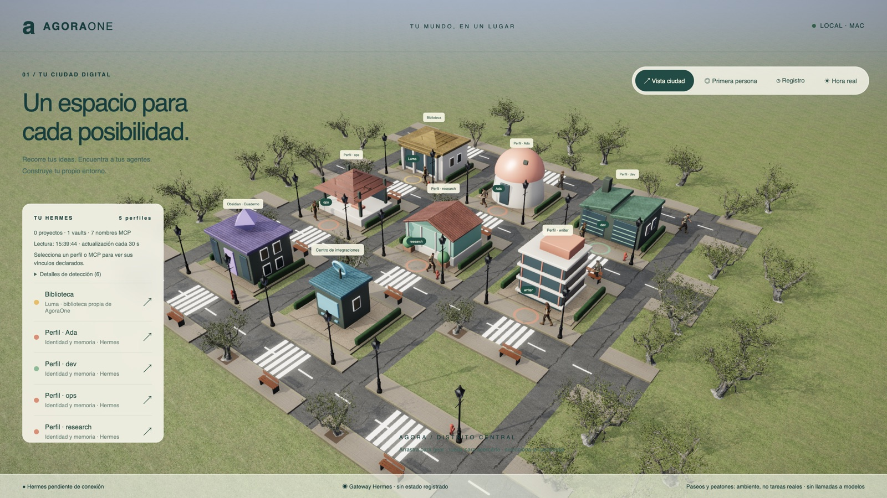
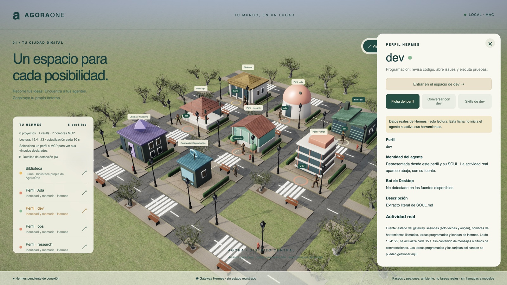

# AgoraOne

**Un cerebro personal en tu ordenador: tu correo, tu agenda, tus reuniones, tus notas y tus agentes de [Hermes](https://github.com/NousResearch/hermes-agent) en un solo sitio, con Watson para ayudarte y una ciudad 3D para recorrerlos.**



<sub>Capturas hechas sobre una instalación de ejemplo con perfiles, MCP y notas ficticios.</sub>

## Qué es y para qué sirve

Cuando usas Hermes con varios perfiles (un asistente principal, uno para programar, otro para investigar…), toda su información vive repartida en carpetas: personalidad, memoria, servidores MCP, skills, tareas programadas, tableros kanban, registros de actividad. AgoraOne lo lee y lo convierte en un lugar:

- **Cada perfil es un edificio** con su propio interior. Entras y ves su identidad, su memoria, sus skills, sus tareas y lo que ha hecho últimamente.
- **Puedes hablar con cada perfil** usando su propio agente, sus herramientas y su memoria, y aprobar una a una las acciones que cambien algo.
- **Tus vaults de Obsidian son bibliotecas**: las carpetas son estanterías y cada nota se abre como un libro.
- **Los servidores MCP** de todos tus perfiles se reúnen en un centro de integraciones.

Alrededor de esa ciudad, AgoraOne reúne tu día a día: Watson, un asistente que responde con tus notas y propone acciones que tú confirmas; tu correo y tu WhatsApp en una bandeja; tu agenda; tus reuniones grabadas, transcritas en el equipo y resumidas; tus facturas por trimestre; y tus clientes y proyectos, con las herramientas externas que conectes.

Sirve para tener una vista de conjunto de tu trabajo y de tus agentes, revisar y corregir lo que saben de ti, y gestionarlo sin abrir archivos a mano ni usar la terminal. Nada se envía, se crea ni se borra sin que veas antes exactamente qué se hará y lo confirmes.



## Funciones

| Área | Qué puedes hacer |
| --- | --- |
| **Ciudad** | Se genera a partir de los perfiles detectados, con ciclo de día y noche según la hora real. Vista aérea o paseo en primera persona. |
| **Perfiles** | Ver y editar su personalidad (SOUL.md), su memoria (MEMORY.md) y lo que sabe de ti (USER.md), con confirmación y copia previa. |
| **Skills** | Ver, crear y editar las skills de cada perfil. Las líneas que parecen claves quedan ocultas. |
| **Tareas y kanban** | Pausar, ejecutar, editar, crear o archivar tareas programadas y tarjetas del tablero de cada perfil, con las funciones de Hermes. |
| **Actividad real** | Estado del gateway, conexiones y actividad de cada perfil, leídos de los registros de Hermes sin el contenido de los mensajes. |
| **Conversación** | Hablar con un perfil como lo haría su bot: su modelo, sus herramientas y su memoria. Cada acción que cambie algo espera a que pulses «Permitir». |
| **Centro de integraciones** | Los servidores MCP de todos los perfiles y su catálogo de herramientas. Puedes ejecutar una herramienta a mano tras revisar el JSON exacto. |
| **Obsidian** | Recorrer tus vaults como una librería, leer notas con formato y enlaces internos, buscar en el contenido, y editar o crear notas con un editor visual en vivo. |
| **Navegación** | Paleta de comandos con ⌘K para ir a cualquier lugar o acción, directorio agrupado con buscador (`/`) y avisos cuando un chat espera tu permiso. |
| **Correo y Bandeja** | Leer tus cuentas en solo lectura, con reglas y resúmenes; tarjetas con lo que pide algo de ti; responder con vista previa exacta y envío solo al pulsar «Enviar»; pasar el correo de un cliente a una nota nueva en su carpeta del vault. Ver [docs/correo-bandeja.md](docs/correo-bandeja.md). |
| **Fiscal** | El trimestre de cada carpeta fiscal leído de sus facturas, avisos de lo que falta o no cuadra, Qonto y el Excel para el gestor. Ver [docs/fiscal.md](docs/fiscal.md). |
| **Agenda y avisos** | Calendarios y recordatorios de macOS con los solapes marcados, llamadas perdidas sin devolver, reuniones próximas, plazos de correos y resumen de la mañana como notificaciones. Ver [docs/agenda-avisos.md](docs/agenda-avisos.md). |
| **Trabajos** | Las tareas programadas y el kanban de todos los perfiles con el tiempo, los tokens y el coste de cada ejecución; encargos al bot central o a cualquier perfil con su historia; y los proyectos de tus clientes con lo que han gastado en ellos los agentes. Ver [docs/trabajos.md](docs/trabajos.md). |
| **Watson** | Responde con tus notas y su memoria, y propone notas, eventos, presupuestos en borrador o limpiar el correo; cada propuesta llega como una tarjeta con lo que se hará y solo se ejecuta al confirmarla. Ver [docs/watson-actua.md](docs/watson-actua.md). |
| **Voz** | Dictado en todos los chats, «Oye Watson» (apagado por defecto) y respuestas habladas. La voz se transcribe siempre en el equipo con whisper.cpp. Ver [docs/voz-musica.md](docs/voz-musica.md). |
| **Reuniones** | Grabar una reunión con un botón y un indicador visible, transcribirla en el equipo, resumirla y pasar sus tareas a recordatorios, a una nota del vault o a una issue de GitHub tras confirmar cada una. Ver [docs/reuniones-voz.md](docs/reuniones-voz.md). |
| **WhatsApp** | Las conversaciones de tu WhatsApp Business (a través de Zernio) en la Bandeja junto al correo, sin marcarlas como leídas; responder con vista previa y un solo envío al pulsar «Enviar». Ver [docs/whatsapp.md](docs/whatsapp.md). |
| **Clientes** | Un directorio con tus clientes de Central, de CRMDev y los que añadas a mano, enlazados sin duplicar, con su correo, sus reuniones y sus proyectos. |
| **Conectores** | Un solo sitio para conectar Central (clientes, proyectos, webs, servidores y agenda), CRMDev (proyectos, tareas, tickets y clientes), Mi fábrica, CostGuard y el MCP del cerebro. Los cambios en Central y CRMDev se hacen tras ver el cambio exacto, y nunca se borra nada. Ver [docs/conectores.md](docs/conectores.md). |
| **Presupuestos** | Ver los presupuestos de Central y crear borradores; enviarlos o cambiar su fase sigue siendo cosa de Central. |
| **Orca** | Desde un correo, una nota o un proyecto, abrir un espacio de trabajo nuevo en Orca y arrancar Claude Code o Codex con un encargo, tras ver repositorio, agente e indicaciones exactas. Ver [docs/orca.md](docs/orca.md). |
| **Jev** | Decisiones tipadas de TypeSafe (clase, prioridad, destino), evaluadas en sombra antes de sustituir a ninguna lógica actual y solo con lo que ya puede salir del equipo. Ver [docs/jev.md](docs/jev.md). |
| **Música** | Pedir «pon …» por voz o por escrito: tu biblioteca, Apple Music o YouTube, con sus controles en el pie del Cerebro. |
| **Módulos** | Apagar lo que no uses desde Ajustes, y ver en «Qué tengo instalado» qué piezas faltan y cómo conseguirlas. Ver [docs/instalacion-modulos.md](docs/instalacion-modulos.md). |
| **Biblioteca y Luma** | Importar TXT, Markdown, PDF y DOCX como copias privadas y consultarlas con Luma, una asistente sin herramientas. |

Los paseantes y el movimiento de la ciudad son decorativos: no representan tareas reales y no llaman a ningún modelo.

## Qué necesitas

- Para usar la app: un **Mac con Apple Silicon** (macOS 13 o superior). La app es autocontenida: lleva su servidor, su Python y la interfaz.
- Solo en macOS: calendarios y recordatorios, historial de llamadas y Contactos, Apple Music, el audio del sistema en las reuniones y arrancar Mi fábrica. El código se escribe pensando también en Linux y Windows, pero no hay app para ellos y **en Windows todavía no compila**.
- Opcional, según los módulos que uses: whisper.cpp y ffmpeg para la voz y las reuniones, y las cuentas de Central, CRMDev, Zernio o TypeSafe. Las claves se guardan en el Llavero del sistema.
- Para desarrollar: **Rust** estable (con `cargo`), **Node.js 22.12 o superior** para la interfaz y [**uv**](https://docs.astral.sh/uv/) para el núcleo Python.
- **Hermes** instalado en `~/.hermes`. Si está en otra ruta, indícala con `AGORA_HERMES_HOME` y `AGORA_HERMES_PATH`.
- Para conversar con Luma, un **proveedor de inferencia compatible con OpenAI** (modelo, URL y clave). Los perfiles usan su propia configuración de Hermes.
- Opcional: **Obsidian**, para ver tus vaults. Se detectan solos.
- Un navegador con WebGL. La ciudad se ve mejor con aceleración gráfica.

## Puesta en marcha

```sh
git clone https://github.com/yosnap/agoraone.git
cd agoraone
cp .env.example .env   # completa AGORA_MODEL, AGORA_BASE_URL y AGORA_API_KEY
pnpm install --frozen-lockfile
pnpm dev
```

`pnpm dev` arranca el servidor de AgoraOne (Rust, en `127.0.0.1:4317`), su núcleo Python y la interfaz con Vite. Abre el enlace privado que muestra la terminal («Abre AgoraOne con este enlace…») o ejecuta `pnpm open`. Solo hace falta la primera vez en cada navegador.

### App de escritorio

`desktop/scripts/empaquetar.sh` construye `AgoraOne.app`, firmada y, si se le da un perfil de notarización, notarizada. La app entra sin enlace, guarda tus datos en `~/Library/Application Support/AgoraOne` y usa el Claude Code que tengas instalado. Detalles en [docs/app-escritorio.md](docs/app-escritorio.md).

Más detalle en [docs/arranque.md](docs/arranque.md). La arquitectura está en [docs/arquitectura.md](docs/arquitectura.md).

## Privacidad y seguridad

AgoraOne está pensado para usarse en tu propio ordenador:

- El servidor escucha **solo en `127.0.0.1`**. Toda la API exige un token de acceso guardado en `.agora/access-token`, legible solo por tu usuario.
- **Las credenciales se quedan en el servidor** (las de los servicios externos, en el Llavero del sistema) y nunca llegan al navegador ni al modelo. Las líneas que parecen claves se ocultan al mostrar archivos.
- **No modifica tu instalación de Hermes.** Solo escribe en los archivos de identidad, las skills y las notas, cuando tú lo pides y lo confirmas, y siempre con una copia previa.
- Ninguna acción con efectos se ejecuta sin que pulses «Permitir» o el botón de su tarjeta, aunque el perfil tenga las aprobaciones desactivadas. El texto de un correo, un mensaje o una web es siempre dato, nunca instrucciones.
- Lo que marques como «solo en este Mac» o privado no va a modelos remotos.

Si encuentras un problema de seguridad, consulta [SECURITY.md](SECURITY.md).

## Estado del proyecto

En desarrollo activo; la última versión publicada es la 1.7.0. Lo que está conectado, lo pendiente y lo ilustrativo se detalla en [docs/estado.md](docs/estado.md). Entre las próximas mejoras están una vista sin 3D para equipos modestos y la app para Linux y Windows.

## Pruebas

```sh
cargo test --manifest-path desktop/Cargo.toml   # pruebas del servidor (Rust)
pnpm test:core                                # pruebas del núcleo (Python)
pnpm test                                         # pruebas de la interfaz
pnpm build                                    # tipos y compilación de la interfaz
```

## Colaborar

Las contribuciones son bienvenidas. Lee [CONTRIBUTING.md](CONTRIBUTING.md) antes de abrir un issue o una pull request, y respeta el [código de conducta](CODE_OF_CONDUCT.md).

## Licencia

Código bajo licencia [MIT](LICENSE). Los recursos visuales de `public/world` son CC0 (Poly Haven y Quaternius); su procedencia está en [docs/recursos-visuales.md](docs/recursos-visuales.md). AgoraOne es un proyecto independiente y no está afiliado a Nous Research.
