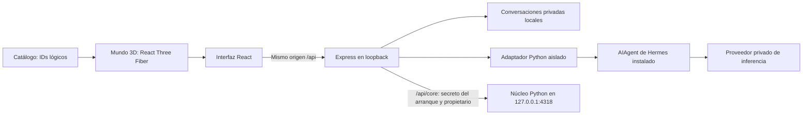

# Arquitectura local

## Núcleo Python (desde 1.0.0)
El núcleo (`core/`, paquete `agora_core`, Python 3.13 con uv y FastAPI) alojará el cerebro, el asistente y los complementos. Express sigue siendo la única puerta del navegador:

- `server/core-process.ts` lo lanza con un secreto aleatorio en cada arranque y un entorno mínimo (sin `.env` ni claves del backend), y lo detiene al salir. El núcleo vigila a su proceso padre y termina si desaparece.
- `server/core-proxy.ts` reenvía `/api/core/*` tras las comprobaciones de siempre (Host, Origin, cookie de acceso y CSRF también en GET). Añade el secreto y el propietario autenticado; no reenvía las cookies del navegador; solo usa la ruta y la consulta de la petición, así que no puede apuntar a otro servidor; limita el cuerpo a 1 MiB y transmite la respuesta en streaming (apto para SSE). Si el núcleo no responde, 503.
- El núcleo rechaza toda petición sin el secreto (comparación en tiempo constante) o con un Host distinto de `127.0.0.1:4318`, y no publica documentación de su API.
- Datos en `.agora/core` (`AGORA_CORE_DATA`): SQLite con WAL y claves foráneas (`core/agora_core/db.py`), migraciones SQL numeradas en `core/agora_core/migrations/` aplicadas al arrancar, cada una en su transacción y con copia previa si ya hay datos. Modelo: ámbitos y tipos como ejes independientes, proyectos, actividades con fecha, elementos indexados con su confidencialidad (`normal`, `local_only`, `private`), línea de tiempo, registro de acciones y agentes.
- Índice del cerebro: el backend (`server/brain-sync.ts`) recorre los vaults de Obsidian con el lector de siempre (`VaultNotes`: solo Markdown, sin enlaces simbólicos ni carpetas ocultas, 256 KiB por nota, líneas que parecen claves enmascaradas) y envía al núcleo solo las notas nuevas o cambiadas, por `/internal/index/*`; al arrancar y cada 5 minutos (30 s si algo falló), y retira las borradas salvo si el recorrido quedó truncado. Un vault que falla no frena a los demás; un vault que sale del registro de Obsidian sale del índice (uno desconectado se conserva). Títulos y carpetas con pinta de clave se envían ocultos. El proxy del navegador no reenvía `/internal`, así que el navegador no puede escribir en el índice. El núcleo nunca lee el vault.
- El núcleo (`index.py`, `embed.py`, `search.py`, `routes_index.py`) parte cada nota en fragmentos de unos 1000 caracteres, los indexa con FTS5 sin tildes y les calcula embeddings locales con ollama (`qwen3-embedding:0.6b`, solo en 127.0.0.1) en segundo plano. `GET /search` fusiona por rango las coincidencias por palabras y por significado; un fragmento solo cuenta por significado si destaca sobre el resto del índice (z ≥ 3,2, calibrado con un vault real). Sin ollama, busca solo por palabras y lo indica. `GET /index/status` da el avance y si la búsqueda por significado funciona en ese momento. Ollama se llama siempre sin proxy (ni de entorno ni del sistema) y sin seguir redirecciones. La matriz de vectores en memoria se rehace cuando cambia un contador que mantienen triggers (los ids de fragmentos se reutilizan al editar una nota). El trabajador de embeddings sobrevive a cualquier error y lo informa.
- Confidencialidad de las notas: `normal` salvo que sus propiedades digan `confidencialidad: solo-local` o `privado` (un valor desconocido cuenta como privado) o que una regla de carpeta (`GET/PUT /index/folder-rules`) lo eleve; gana la más estricta; las propiedades se leen con tolerancia (comillas, BOM, claves repetidas) y cuenta la mención más estricta. Las reglas comparan carpetas normalizadas (NFC, sin mayúsculas, barras uniformes). Cada búsqueda debe indicar su destinatario y el núcleo filtra antes de ordenar: `audience=owner` (el usuario en este Mac) lo ve todo; `audience=external` (un modelo fuera del Mac, Telegram o MCP) nunca recibe `local_only` ni `private`. Sin destinatario, la búsqueda se rechaza.
- Asistente (`assistant.py`, `engines.py`, `routes_assistant.py`): motores en orden automático, salvo preferencia en Ajustes: Claude Agent SDK con la sesión local de Claude Code del usuario (el núcleo quita de su entorno las variables de API al arrancar y hereda `USER`, `LOGNAME` y `CLAUDE_CONFIG_DIR` para encontrar la sesión), API de Anthropic con clave en el Llavero, y proveedor compatible con OpenAI (https, sin proxy ni redirecciones, clave en el Llavero). AgoraOne no pide ni guarda credenciales de claude.ai. Todos los motores son externos: el asistente busca con `audience=external` y pasa las notas numeradas dentro de `<notas>` como datos, nunca como instrucciones (sus etiquetas se neutralizan sin distinguir mayúsculas). Desde 1.0.0-alpha.8 el asistente busca por sí mismo (`brain_tools.py`): además de las notas de la primera búsqueda, tiene `buscar_en_cerebro` y `leer_nota` (solo por el número de una nota ya encontrada, en partes de 8.000 caracteres), siempre con destinatario `external` y con un tope de 8 llamadas por respuesta; cada búsqueda y lectura sale por el SSE como evento `tool` y las fuentes guardadas son las citadas. Claude Code recibe esas dos herramientas como servidor MCP en proceso y ninguna más (sin herramientas propias de Claude Code, `--tools ""`), sin los MCP del usuario, en una carpeta vacía (`.agora/core/claude-code`) y sin guardar sesión en disco. Si un motor falla antes de escribir, se prueba el siguiente; si falla a mitad, no se cambia en silencio. El proveedor compatible solo admite direcciones https públicas (ni este Mac ni la red local, comprobado también al resolver el nombre) y su clave se olvida si cambia la dirección. Las conversaciones pertenecen al acceso de AgoraOne (mismo propietario en cualquier navegador) y una pregunta sin respuesta se guarda marcada como fallida. Personajes de dominio público (Watson por defecto) y tono configurable; modelo Sonnet por defecto. Conversaciones y mensajes, con fuentes, motor y modelo, en la base del núcleo por propietario (migración 0004). La respuesta llega por SSE: etapas `recuerda`, `piensa` y `responde`, fuentes, texto y `done` o `error`.
- Complementos (`addons.py`, `routes_addons.py`): Central, CostGuard y mi fábrica se describen con manifiestos genéricos; dónde están en este Mac (ruta, puerto, archivo de datos) lo guarda el usuario en la base del núcleo, validado contra los propios archivos del complemento. `GET /addons` da su estado (sin configurar, no encontrado, ilegible, detectado, `responding` si su web contesta o `recording` si CostGuard tiene consumo reciente; comprobado solo contra 127.0.0.1, sin proxy ni redirecciones; un complemento roto nunca rompe el registro). Cada complemento acepta solo sus ajustes y un valor nulo los olvida y `GET /addons/costguard/usage` el consumo de tokens por agente leyendo la base de CostGuard en modo solo lectura. AgoraOne no arranca, detiene ni modifica ningún complemento.
- Grafo del cerebro (`graph.py`, migración 0006): al indexar, el núcleo guarda los enlaces `[[...]]` de cada nota (destino normalizado: último tramo, sin `.md`, encabezado, bloque ni alias; fuera de bloques de código). `GET /graph?discreet=&near=` devuelve las notas (hasta 1.500, las más recientes) con su grado y las aristas `link` (enlace resuelto por título dentro del mismo vault) y `near` (las 3 notas más cercanas por el vector medio de sus fragmentos, si destacan z ≥ 2 sobre el resto de pares). Es solo para la pantalla del propietario; en modo discreto, solo notas `normal`. `GET /brain-mcp` da la orden exacta para conectar el MCP del cerebro a un perfil de Hermes (AgoraOne no la ejecuta).
- MCP del cerebro (`brain_mcp.py`): servidor por stdio de solo lectura para Hermes y otros clientes, siempre con destinatario `external`; abre la base en modo solo lectura y funciona con AgoraOne cerrado. Ver docs/mcp-cerebro.md.
- Copias (`core/agora_core/backup.py`): instantánea en memoria con la API de SQLite (la copia sin cifrar nunca toca el disco), comprimida y cifrada con AES-256-GCM; clave en el Llavero (`keystore.py`), creada una sola vez y con bloqueo entre hilos y procesos; retención diaria, semanal, manual y previa a migraciones; restauración solo por terminal (`cli.py`) con el núcleo parado. Cada operación abre su propia conexión a SQLite. Instrucciones en docs/arranque.md.

## Módulos
- `src/world`: geometría, selección, cámaras, movimiento y colisiones exteriores sencillas. No conoce credenciales ni llama a modelos.
- `src/ui`: conversación y estados visibles. Solo una respuesta efectiva se etiqueta como recibida de Hermes.
- `src/data`: catálogo y vínculos por identificadores, sin rutas del disco.
- `src/api`: contrato HTTP de AgoraOne, independiente de los endpoints de Hermes.
- `server/app.ts`: validación, origen/host/CSRF, identidad local y autorización por conversación.
- `server/conversations.ts`: persistencia atómica JSON con permisos 0600, directorio privado.
- `server/document-extraction.ts` y `extract-document.mjs`: validación y extracción de PDF/DOCX en proceso limitado sin credenciales; persisten solo texto mediante `private-library.ts`.
- `server/hermes-location.ts`, `hermes-catalog.ts`, `hermes-safe-read.ts`, `hermes-database.ts`: detección local y catálogo de solo lectura, independiente de la ejecución AIAgent. Contrato en shared/hermes-catalog.ts, proyección visual en src/data/city.ts y ficha en src/ui/hermes-panel.tsx.
- `server/profile-editor.ts` y `hermes_profile_write.py`: única escritura en perfiles de Hermes, limitada a SOUL.md, MEMORY.md y USER.md desde la ficha, con confirmación, copia previa, control de revisión y el bloqueo de memoria de Hermes (docs/edicion-perfiles.md).
- `server/hermes-adapter.ts`, `hermes-worker.ts` y `hermes_bridge.py`: procesos exclusivos por conversación reutilizables durante cinco minutos, agente nuevo por turno, streaming, configuración, timeout y capacidades. Ver latencia-chat.md.
- `server/profile-context.ts` y `hermes_identity.py`: snapshot autorizado de identidad por turno y construcción del prompt; sin lectura de rutas desde el proceso del modelo. Los perfiles conversan en hogares separados por sesión bajo .agora/hermes-conversations.

## Interfaz (desde 1.0.0-alpha.7)
`src/shell/` es la raíz: barra lateral (abajo en móvil) con Cerebro (inicio), Asistente, Oficina 3D, Conectores y Ajustes, modo discreto de un clic y Bandeja, Trabajos, Reuniones y Fiscal marcadas como pendientes. La sección y el modo discreto se recuerdan por navegador; `?seccion=oficina|cerebro|asistente|conectores|ajustes` abre una sección (las verificaciones de navegador entran por la oficina con `appUrl()`). La Oficina 3D es la ciudad de siempre (`src/app.tsx`, `Office`): se monta al visitarla y ya no se desmonta, para no perder chats en curso ni sus «Permitir»; fuera de su sección queda oculta, con la escena en pausa (`frameloop="never"`) y sin atajos. El resto de secciones se cargan aparte con `React.lazy`: `src/brain` (grafo 3D con disposición por fuerzas determinista en el navegador, sin modelos, quieto con «reducir movimiento»; las notas se abren con el libro del vault), `src/assistant` (conversaciones, SSE, motor y modelo de cada respuesta, fuentes que abren la nota o se resaltan en el grafo), `src/connectors` y `src/settings`. El cliente del núcleo está en `src/api/core.ts`. Desde 1.0.0-alpha.8 el Cerebro lleva la conversación con Watson a la derecha del grafo y una barra con sus etapas reales (recuerda, busca, lee, piensa, responde) que resalta las notas que lee. Enter envía en todos los chats (Mayús+Enter, nueva línea). Tema claro, oscuro o del sistema desde la barra lateral: cada color de las hojas de estilo es un token generado por `node scripts/theme-tokens.mjs` en `src/theme-tokens.css` (hay que volver a ejecutarlo al añadir colores); las superficies oscuras en ambos temas usan `--deep*` y el texto sobre la escena 3D conserva sus colores de día y noche.

## Identidades
Personaje Luma → agente lógico `luma` → contexto `library-lobby`. Perfil Hermes y bot: `null`; no se mapean a los del usuario. Cada conversación recibe UUID propio y otro ID de sesión Hermes generado en backend. El historial que llega al modelo procede del almacenamiento del servidor, nunca del cliente.

Perfiles detectados: conversación ligada a profileId, agentId y contexto profile-chat:<profileId>, además del propietario. Cada envío revalida identidad y memoria del perfil. Desde 0.13.0 corre el agente real del perfil (`server/hermes_agent_bridge.py`): su proveedor, sus toolsets de Telegram, sus MCP y su memoria. Toda herramienta que no sea de solo lectura pasa por la confirmación del usuario (`POST /api/conversations/:id/approvals/:requestId`); ver docs/conversaciones-perfiles.md. El cliente no puede sustituir perfil, historia o capacidades de una conversación existente.

La identidad de usuario local es un token aleatorio HttpOnly, SameSite=Strict; se almacena su hash como propietario. La cookie equivale a la credencial local del navegador, no a una cuenta de usuario. El backend rechaza IDs ajenos. El cliente conserva únicamente el ID de conversación en localStorage. La cookie dura 30 días; perderla deja el historial inaccesible desde esa identidad. Los archivos permanecen locales.

Las importaciones usan la misma identidad. `server/private-library.ts` guarda copias en `.agora/library/<owner>`, valida datos y permisos en lectura y antes de invocar Hermes. El selector envía nombre y bytes, nunca una ruta física. Los ejemplos son compartidos, las copias importadas privadas. Ver docs/importacion.md.

## Límites de confianza
Vite escucha en `127.0.0.1:5173`, Express en `127.0.0.1:4317`; ambos puertos fijos. Acceso (0.18.0): toda la API exige la cookie `agora_access` (HttpOnly, SameSite=Strict, un resumen del token de `.agora/access-token`, 0600), que el navegador obtiene una vez con el enlace privado (`POST /api/session`); así otro usuario del equipo, una app aislada o un contenedor que alcance 127.0.0.1 no puede usarla aunque falsifique Host y Origin. Ninguna web puede incrustar la app (`X-Frame-Options: DENY`, `frame-ancestors 'none'`). El extractor de PDF/DOCX corre con el modelo de permisos de Node (solo lee su código y sus librerías). Informe completo: plans/reports/security-261018-2245-auditoria-completa.md. Backend valida Host y Origin, exige token CSRF en mutaciones y no permite que el cliente elija herramientas, modelo, usuario o sesión Hermes. Sin CORS abierto. Credenciales nunca tienen prefijo VITE_. No se sirven `.env` ni `.agora` desde Express; solo `dist`.

Backend y navegador se ejecutan localmente; la inferencia viaja al proveedor privado elegido. El movimiento no produce llamadas de inferencia. El build y las dependencias se descargan durante instalación, pero la escena no necesita fuentes ni modelos 3D remotos.

## Evolución de recursos
Los edificios representan IDs como `library-lobby`. El recurso `library-test` tiene registro cerrado en `server/library.ts`, raíz resources/library-test, solo lectura, validación de realpath, enlaces, tamaño y formato. El backend adjunta el documento seleccionado a cada petición Hermes; el agente conserva cero herramientas. Para evolucionar a búsqueda autónoma, diseñar herramientas específicas por ejecución; no activar terminal genérico ni acceso global al disco.

Vista general, primera persona exterior y biblioteca interior están disponibles. Los otros interiores, física Rapier, avatares complejos y WebXR se incorporarán por hitos; capacidades de Quest y Vision Pro se comprobarán independientemente. Las etiquetas DOM tienen ciclo de vida propio en WorldLabel para evitar conflictos al cambiar escenas de R3F.

La ciudad ya no usa los cinco agentes ficticios como inventario: recibe perfiles y espacios de /api/hermes/catalog. Un personaje representa la identidad de un perfil, no una sesión activa; la ficha explica su vínculo con Bots de Desktop. Luma se conserva aparte como función de AgoraOne. Ver docs/catalogo-hermes.md para capacidades, fuentes y límites de portabilidad.

## Lecturas en segundo plano y carga del frontend
Las lecturas síncronas pesadas (actividad de Hermes con `node:sqlite` y notas de Obsidian) se ejecutan en un `worker_threads` de larga vida (`server/read-worker.ts`), así que el servidor responde a otras peticiones mientras tanto; el worker conserva sus cachés. El cliente del hilo principal (`server/background-reads.ts`) admite como máximo 8 tareas en espera (la novena se rechaza al momento) y da 20 s a cada tarea desde que empieza a ejecutarse, no desde que se encola; si una tarea se pasa, sustituye el worker y solo falla lo que tenía ese worker. Las rutas reciben del catálogo las carpetas de cada perfil; el cliente nunca envía rutas.

En el navegador, la escena 3D (`src/world/city.tsx` con three.js, React Three Fiber y el posprocesado) se carga con `React.lazy` en un trozo propio de unos 1,4 MB; la interfaz (unos 270 KB) se puede usar antes. Si ese trozo no se descarga, solo la escena muestra un aviso y el directorio y el chat siguen disponibles.
