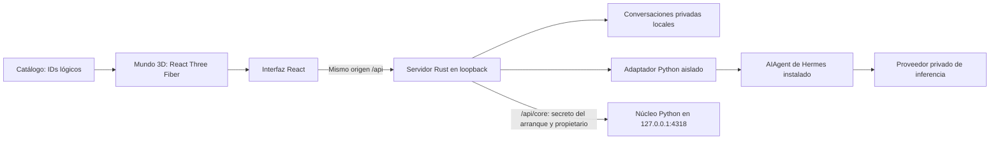

# Arquitectura local

## Núcleo Python (desde 1.0.0)
El núcleo (`core/`, paquete `agora_core`, Python 3.13 con uv y FastAPI) aloja el cerebro, el asistente y los complementos. El servidor de AgoraOne (Rust) es la única puerta del navegador:

- `desktop/server/src/core.rs` lo lanza con un secreto aleatorio en cada arranque y un entorno mínimo (sin `.env` ni claves del backend), y lo detiene al salir. El núcleo vigila a su proceso padre y termina si desaparece.
- `desktop/server/src/core.rs` reenvía `/api/core/*` tras las comprobaciones de siempre (Host, Origin, cookie de acceso y CSRF también en GET). Añade el secreto y el propietario autenticado; no reenvía las cookies del navegador; solo usa la ruta y la consulta de la petición, así que no puede apuntar a otro servidor; limita el cuerpo a 1 MiB y transmite la respuesta en streaming (apto para SSE). Si el núcleo no responde, 503.
- El núcleo rechaza toda petición sin el secreto (comparación en tiempo constante) o con un Host distinto de `127.0.0.1:4318`, y no publica documentación de su API.
- Datos en `.agora/core` (`AGORA_CORE_DATA`): SQLite con WAL y claves foráneas (`core/agora_core/db.py`), migraciones SQL numeradas en `core/agora_core/migrations/` aplicadas al arrancar, cada una en su transacción y con copia previa si ya hay datos. Modelo: ámbitos y tipos como ejes independientes, proyectos, actividades con fecha, elementos indexados con su confidencialidad (`normal`, `local_only`, `private`), línea de tiempo, registro de acciones y agentes.
- Índice del cerebro: el backend (`desktop/server/src/brain_sync.rs`) recorre los vaults de Obsidian con el lector de siempre (`VaultNotes`: solo Markdown, sin enlaces simbólicos ni carpetas ocultas, 256 KiB por nota, líneas que parecen claves enmascaradas) y envía al núcleo solo las notas nuevas o cambiadas, por `/internal/index/*`; al arrancar y cada 5 minutos (30 s si algo falló), y retira las borradas salvo si el recorrido quedó truncado. Un vault que falla no frena a los demás; un vault que sale del registro de Obsidian sale del índice (uno desconectado se conserva). Títulos y carpetas con pinta de clave se envían ocultos. El proxy del navegador no reenvía `/internal`, así que el navegador no puede escribir en el índice. El núcleo nunca lee el vault.
- El núcleo (`index.py`, `embed.py`, `search.py`, `routes_index.py`) parte cada nota en fragmentos de unos 1000 caracteres, los indexa con FTS5 sin tildes y les calcula embeddings locales con ollama (`qwen3-embedding:0.6b`, solo en 127.0.0.1) en segundo plano. `GET /search` fusiona por rango las coincidencias por palabras y por significado; un fragmento solo cuenta por significado si destaca sobre el resto del índice (z ≥ 3,2, calibrado con un vault real). Sin ollama, busca solo por palabras y lo indica. `GET /index/status` da el avance y si la búsqueda por significado funciona en ese momento. Ollama se llama siempre sin proxy (ni de entorno ni del sistema) y sin seguir redirecciones. La matriz de vectores en memoria se rehace cuando cambia un contador que mantienen triggers (los ids de fragmentos se reutilizan al editar una nota). El trabajador de embeddings sobrevive a cualquier error y lo informa.
- Confidencialidad de las notas: `normal` salvo que sus propiedades digan `confidencialidad: solo-local` o `privado` (un valor desconocido cuenta como privado) o que una regla de carpeta (`GET/PUT /index/folder-rules`) lo eleve; gana la más estricta; las propiedades se leen con tolerancia (comillas, BOM, claves repetidas) y cuenta la mención más estricta. Las reglas comparan carpetas normalizadas (NFC, sin mayúsculas, barras uniformes). Cada búsqueda debe indicar su destinatario y el núcleo filtra antes de ordenar: `audience=owner` (el usuario en este Mac) lo ve todo; `audience=external` (un modelo fuera del Mac, Telegram o MCP) nunca recibe `local_only` ni `private`. Sin destinatario, la búsqueda se rechaza.
- Asistente (`assistant.py`, `engines.py`, `routes_assistant.py`): motores en orden automático, salvo preferencia en Ajustes: Claude Agent SDK con la sesión local de Claude Code del usuario (el núcleo quita de su entorno las variables de API al arrancar y hereda `USER`, `LOGNAME` y `CLAUDE_CONFIG_DIR` para encontrar la sesión), API de Anthropic con clave en el Llavero, y proveedor compatible con OpenAI (https, sin proxy ni redirecciones, clave en el Llavero). AgoraOne no pide ni guarda credenciales de claude.ai. Todos los motores son externos: el asistente busca con `audience=external` y pasa las notas numeradas dentro de `<notas>` como datos, nunca como instrucciones (sus etiquetas se neutralizan sin distinguir mayúsculas). Desde 1.0.0-alpha.8 el asistente busca por sí mismo (`brain_tools.py`): además de las notas de la primera búsqueda, tiene `buscar_en_cerebro` y `leer_nota` (solo por el número de una nota ya encontrada, en partes de 8.000 caracteres), siempre con destinatario `external` y con un tope de 8 llamadas por respuesta; cada búsqueda y lectura sale por el SSE como evento `tool` y las fuentes guardadas son las citadas. Claude Code recibe esas dos herramientas como servidor MCP en proceso y ninguna más (sin herramientas propias de Claude Code, `--tools ""`), sin los MCP del usuario, en una carpeta vacía (`.agora/core/claude-code`) y sin guardar sesión en disco. Si un motor falla antes de escribir, se prueba el siguiente; si falla a mitad, no se cambia en silencio. El proveedor compatible solo admite direcciones https públicas (ni este Mac ni la red local, comprobado también al resolver el nombre) y su clave se olvida si cambia la dirección. Las conversaciones pertenecen al acceso de AgoraOne (mismo propietario en cualquier navegador) y una pregunta sin respuesta se guarda marcada como fallida. Personajes de dominio público (Watson por defecto) y tono configurable; modelo Sonnet por defecto. Conversaciones y mensajes, con fuentes, motor y modelo, en la base del núcleo por propietario (migración 0004). La respuesta llega por SSE: etapas `recuerda`, `piensa` y `responde`, fuentes, texto y `done` o `error`.
- Complementos (`addons.py`, `routes_addons.py`): Central, CostGuard y mi fábrica se describen con manifiestos genéricos; dónde están en este Mac (ruta, puerto, archivo de datos) lo guarda el usuario en la base del núcleo, validado contra los propios archivos del complemento. `GET /addons` da su estado (sin configurar, no encontrado, ilegible, detectado, `responding` si su web contesta o `recording` si CostGuard tiene consumo reciente; comprobado solo contra 127.0.0.1, sin proxy ni redirecciones; un complemento roto nunca rompe el registro). Cada complemento acepta solo sus ajustes y un valor nulo los olvida y `GET /addons/costguard/usage` el consumo de tokens por agente leyendo la base de CostGuard en modo solo lectura. AgoraOne no arranca, detiene ni modifica ningún complemento.
- Grafo del cerebro (`graph.py`, migración 0006): al indexar, el núcleo guarda los enlaces `[[...]]` de cada nota (destino normalizado: último tramo, sin `.md`, encabezado, bloque ni alias; fuera de bloques de código). `GET /graph?discreet=&near=` devuelve las notas (hasta 1.500, las más recientes) con su grado y las aristas `link` (enlace resuelto por título dentro del mismo vault) y `near` (las 3 notas más cercanas por el vector medio de sus fragmentos, si destacan z ≥ 2 sobre el resto de pares). Es solo para la pantalla del propietario; en modo discreto, solo notas `normal`. `GET /brain-mcp` da la orden exacta para conectar el MCP del cerebro a un perfil de Hermes (AgoraOne no la ejecuta).
- Entidades (`entities.py`, `entity_worker.py`, migración 0007): al indexar, reglas locales sacan de cada nota sus #etiquetas (también las de las propiedades), cifras y fechas; en segundo plano, Claude Haiku (por la sesión de Claude Code o, sin ella, la API de Anthropic; nunca el proveedor compatible) lee por lotes de 6 solo las notas `normal` nuevas o cambiadas y extrae personas, organizaciones y proyectos (decisión del usuario: el texto de las notas normales sale a Anthropic; lo `local_only` y `private`, nunca). La nota va como dato dentro de `<nota>` y la respuesta es JSON validado (ids, tipos y textos; lo demás se descarta). `GET /graph` acepta `entities`, `tags` y `folders` y añade esos nodos (las entidades y etiquetas solo si dos notas visibles las comparten; hasta 300) con aristas `mention` e `in`; `GET /index/status` da el avance de la extracción y si está en pausa.
- MCP del cerebro (`brain_mcp.py`): servidor por stdio de solo lectura para Hermes y otros clientes, siempre con destinatario `external`; abre la base en modo solo lectura y funciona con AgoraOne cerrado. Ver docs/mcp-cerebro.md.
- Copias (`core/agora_core/backup.py`): instantánea en memoria con la API de SQLite (la copia sin cifrar nunca toca el disco), comprimida y cifrada con AES-256-GCM; clave en el Llavero (`keystore.py`), creada una sola vez y con bloqueo entre hilos y procesos; retención diaria, semanal, manual y previa a migraciones; restauración solo por terminal (`cli.py`) con el núcleo parado. Cada operación abre su propia conexión a SQLite. Instrucciones en docs/arranque.md.

## Servidor y app de escritorio (desde 1.0.0-alpha.12)
El servidor que antes era Node/Express es ahora Rust (`desktop/server`, crate `agora-server`, con axum) y mantiene el mismo contrato HTTP. `launch.rs` reúne el arranque (token, núcleo, sincronización del cerebro, servidor en 127.0.0.1:4317 y cierre ordenado), que usan el binario `agoraone` (`pnpm dev`, `pnpm start`, `agoraone abrir`, `agoraone comprobar-hermes`) y la app de Tauri (`desktop/app`). Los scripts de Python que escriben en Hermes y los puentes de conversación están en `desktop/server/python` y van incrustados en el binario. La app empaquetada lleva su propio Python con el núcleo, guarda los datos en `~/Library/Application Support/AgoraOne` y usa el Claude Code instalado: ver docs/app-escritorio.md.

## Módulos
- `src/world`: geometría, selección, cámaras, movimiento y colisiones exteriores sencillas. No conoce credenciales ni llama a modelos.
- `src/ui`: conversación y estados visibles. Solo una respuesta efectiva se etiqueta como recibida de Hermes.
- `src/data`: catálogo y vínculos por identificadores, sin rutas del disco.
- `src/api`: contrato HTTP de AgoraOne, independiente de los endpoints de Hermes.
- `desktop/server/src/lib.rs`: validación, origen/host/CSRF, identidad local y autorización por conversación.
- `desktop/server/src/chat/store.rs`: persistencia atómica JSON con permisos 0600, directorio privado.
- `desktop/server/src/library/extract.rs` y `core/agora_core/extract.py`: validación y extracción de PDF/DOCX (pypdf y python-docx) en un proceso aparte con el Python del núcleo, sin credenciales y, en macOS, bajo `sandbox-exec` (sin red, sin escribir archivos, sin procesos hijos y sin leer el contenido de los archivos del usuario: solo su Python y la carpeta del núcleo); persisten solo texto mediante `desktop/server/src/library/mod.rs`.
- `desktop/server/src/hermes/` (`location.rs`, `catalog.rs`, `safe_read.rs`, `database.rs`): detección local y catálogo de solo lectura, independiente de la ejecución AIAgent. Contrato en shared/hermes-catalog.ts, proyección visual en src/data/city.ts y ficha en src/ui/hermes-panel.tsx.
- `desktop/server/src/hermes/profile_editor.rs` y `desktop/server/python/hermes_profile_write.py`: única escritura en perfiles de Hermes, limitada a SOUL.md, MEMORY.md y USER.md desde la ficha, con confirmación, copia previa, control de revisión y el bloqueo de memoria de Hermes (docs/edicion-perfiles.md).
- `desktop/server/src/chat/mod.rs`, `chat/worker.rs` y `desktop/server/python/hermes_bridge.py`: procesos exclusivos por conversación reutilizables durante cinco minutos, agente nuevo por turno, streaming, configuración, timeout y capacidades. Ver latencia-chat.md.
- `desktop/server/src/chat/mod.rs` y `desktop/server/python/hermes_identity.py`: snapshot autorizado de identidad por turno y construcción del prompt; sin lectura de rutas desde el proceso del modelo. Los perfiles conversan en hogares separados por sesión bajo .agora/hermes-conversations.

## Interfaz (desde 1.0.0-alpha.7)
`src/shell/` es la raíz: barra lateral (abajo en móvil) con Cerebro (inicio), Asistente, Oficina 3D, Conectores, Bandeja (desde 1.1.0-alpha.2), Agenda (`src/calendar`, desde 1.1.0-alpha.9), Fiscal (`src/fiscal`, desde 1.1.0-alpha.5) y Ajustes, modo discreto de un clic y Trabajos y Reuniones marcadas como pendientes. Los avisos con la ventana delante salen en `src/shell/alert-toasts.tsx`. La sección y el modo discreto se recuerdan por navegador; `?seccion=oficina|cerebro|resumen|asistente|conectores|bandeja|agenda|fiscal|ajustes` abre una sección (las verificaciones de navegador entran por la oficina con `appUrl()`). Ajustes tiene una pestaña por apartado (General, Asistente, Correo, Agenda y avisos, Fiscal, Trabajos, Privacidad y copias; `src/settings/settings-view.tsx`): `?pestana=correo` abre una y la última usada se recuerda en el navegador. La Oficina 3D es la ciudad de siempre (`src/app.tsx`, `Office`): se monta al visitarla y ya no se desmonta, para no perder chats en curso ni sus «Permitir»; fuera de su sección queda oculta, con la escena en pausa (`frameloop="never"`) y sin atajos. El resto de secciones se cargan aparte con `React.lazy`: `src/brain` (grafo 3D con disposición por fuerzas determinista en el navegador, sin modelos, quieto con «reducir movimiento»; las notas se abren con el libro del vault), `src/assistant` (conversaciones, SSE, motor y modelo de cada respuesta, fuentes que abren la nota o se resaltan en el grafo), `src/connectors` y `src/settings`. El cliente del núcleo está en `src/api/core.ts`. Desde 1.0.0-alpha.8 el Cerebro lleva la conversación con Watson a la derecha del grafo y una barra con sus etapas reales (recuerda, busca, lee, piensa, responde) que resalta las notas que lee. Enter envía en todos los chats (Mayús+Enter, nueva línea). Tema claro, oscuro o del sistema desde la barra lateral: cada color de las hojas de estilo es un token generado por `node scripts/theme-tokens.mjs` en `src/theme-tokens.css` (hay que volver a ejecutarlo al añadir colores); las superficies oscuras en ambos temas usan `--deep*` y el texto sobre la escena 3D conserva sus colores de día y noche.

## Oficina de agentes y sonido (desde 1.0.0-alpha.11)
En la Oficina 3D, `src/office/` añade una tarjeta por agente (Watson y cada perfil de Hermes) con lo que hace de verdad (`agent-state.ts`: espera tu permiso, te responde en AgoraOne, usa una herramienta o ejecutó una tarea en los últimos minutos, actividad reciente, conectado o sin conexión; todo de la actividad de Hermes y de los chats de AgoraOne) y acceso a su conversación, sus tareas y kanban y su espacio; los estados activos salen también sobre su persona en la ciudad. En primera persona, `walk-hud.tsx` enseña siempre los controles y, junto a un edificio, «E» habla con su agente o lo abre. Las teclas del paseo mueven aunque el foco esté en un botón (antes, cualquier clic fuera de la escena las desactivaba sin aviso), salvo escribiendo en un campo o con un diálogo abierto. `src/sound/sound.ts` sintetiza con Web Audio, sin archivos, los avisos de enviar, recibir y pedir permiso, los pasos y un ambiente de viento con pájaros o grillos según la hora; un interruptor en la barra lateral los silencia todos y se recuerda por navegador; el ambiente no suena con «reducir movimiento». `scripts/verify-office.mjs` lo comprueba.

## Resumen (desde 1.0.0-alpha.9)
La sección «Resumen» y la franja sobre el grafo del Cerebro (`src/summary/`) reúnen, cada minuto: Watson en línea y desde cuándo (arranque del núcleo y motor activo), el gateway de Hermes y los perfiles con alguna plataforma conectada (actividad de Hermes de siempre), tokens por proyecto y por agente de CostGuard en 24 h, 7 y 30 días (`addons.costguard_projects`, solo el nombre del proyecto) y de las sesiones de Hermes en 30 días (`desktop/server/src/hermes/summary.rs`, por repositorio o carpeta, solo su nombre), la actividad de Watson (preguntas, consultas con más notas citadas, notas más citadas y búsquedas que repite, que se guardan en `action_log`) y las palabras más usadas en las notas (en modo discreto, solo las normales; sin las marcas de líneas ocultas), en las preguntas a Watson y en los mensajes del usuario en Hermes. Esto último es una excepción decidida por el usuario a «de Hermes solo metadatos»: se cuenta en el hilo de lecturas del backend, solo se guardan recuentos y nunca va a un modelo. Las dos cuentas de palabras usan las mismas reglas (`shared/stopwords.json`, letras de 4 a 20, fuera las cadenas con pinta de clave). `GET /summary` en el núcleo y `GET /api/hermes/summary` en el backend.

## Correo y Bandeja (desde 1.1.0-alpha.1)
Todo vive en el núcleo Python; el servidor de Rust solo hace de proxy (`/api/core/*`).
- **Cuentas** (`mail.py`, `mail_oauth.py`, `routes_mail.py`, migraciones 0008 y 0009). IMAP en solo lectura (EXAMINE y `BODY.PEEK`: nunca marca como leído, mueve ni borra), incremental por UIDVALIDITY y UID, cada cinco minutos y con «Leer ahora». Cada cuenta tiene ámbito, nivel de confidencialidad y antigüedad máxima. Las contraseñas de aplicación están en el Llavero (`mail:<id>`). Microsoft entra con OAuth por código de dispositivo, con el registro de Entra del propio usuario (su identificador se guarda en `setting`), y solo guarda en el Llavero el permiso de renovación.
- **Reglas** (`mail_rules.py`, migración 0010). Condición por remitente o dominio (incluye subdominios), cuenta, asunto o palabras. Acción: factura de proveedor, cliente o proyecto, personal, importante o ignorar. Decide la primera que coincide; una regla solo endurece el nivel de la cuenta. Crear, cambiar o quitar una regla la vuelve a aplicar al momento a lo no decidido, sin llamar a ningún modelo.
- **Clasificación y resúmenes** (`mail_inbox.py`, `mail_summarizer.py`). Un hilo lee en lotes de 6 los correos de los últimos 30 días. Lo de nivel normal va a Claude Haiku (sesión de Claude Code o API de Anthropic) como dato entre marcas `<correo>`. Devuelve JSON validado: tipo (factura, pago, oferta de trabajo, cliente, incidencia, cita, personal, importante, publicidad u otro), resumen, lo que piden, fechas e importes. Lo de solo este Mac o privado se clasifica con palabras clave locales y sin resumen. La publicidad y lo ignorado por regla quedan en silencio.
- **Bandeja** (`routes_inbox.py`, `src/inbox/`). Tarjetas por ámbito que el usuario marca como hechas o descarta. Propone acciones (archivar factura, añadir al proyecto, crear evento) que llegan en fases posteriores y hasta entonces se muestran como pendientes. Ningún correo cambia un estado ni crea una regla: la regla en un clic se construye con el remitente real, nunca con lo que escribe el modelo.
- **Watson**. Consulta la Bandeja con la herramienta de solo lectura `consultar_bandeja`, que solo ve lo de nivel normal. Al abrir el chat anuncia lo pendiente una vez (`src/assistant/assistant-announce.tsx`); un «sí» o un «no» a un único aviso se decide en la interfaz, sin pasar por un modelo.

- **Facturas** (desde 1.1.0-alpha.3: `fiscal.py`, `invoice_extract.py`, `fiscal_folder.py`, `routes_fiscal.py`, migración 0011):
  - **Carpeta fiscal.** Se elige en Ajustes y se guarda en `setting` (`fiscal.folder`). Nunca puede ser la carpeta personal ni la raíz de iCloud Drive, y toda ruta se resuelve y se comprueba dentro de ella.
  - **Preparar.** La tarjeta de un aviso de pago vuelve a leer el correo en solo lectura. Lee el PDF adjunto con el extractor aislado (`sandbox-exec`, sin red ni escrituras) y reglas locales (NIF, fecha, total) y lo coteja con el aviso: lo que no cuadra son dudas. Si la factura solo viene enlazada, propone el enlace; se descarga al archivar, únicamente desde https público, sin redirecciones y si es PDF.
  - **Archivar.** La factura va a `Facturas Entrantes/año/NT/fecha proveedor total.pdf` sin sobrescribir nada y queda en el registro `invoice`.
  - **Reordenar.** Se proponen movimientos deducidos de los nombres de carpeta (lo dudoso no se toca) y se aplican con la lista exacta confirmada, con copia previa en los datos de AgoraOne.
  - **Watson.** En su aviso, un «sí» archiva solo una factura adjunta y sin dudas.

- **Fiscal desde la carpeta** (desde 1.1.0-alpha.4: `fiscal_folder.py`, `fiscal_scan.py`, `invoice_ai.py`, `fiscal_manual.py`, `fiscal_excel.py`, `qonto.py`, `exchange.py`, `receipts.py`; migraciones 0012 a 0017). Varias carpetas con tipo y ámbito; el trimestre se lee de Facturas Salientes y Entrantes en segundo plano, con caché por archivo, Claude Haiku como lector (desactivable; como dato y JSON validado) y reglas locales de respaldo; datos a mano solo para lo ilegible; Qonto en solo lectura; cambio del BCE; Excel del gestor con fórmulas. Recibos desde el móvil con un puerto de un solo uso en la red local durante 10 minutos (la única excepción a escuchar en loopback). Guía: docs/fiscal.md.
- **Clientes** (`central.py`, `central_api.py`, `routes_central.py`). Instantánea en solo lectura de Central, cada 30 minutos mientras el módulo «Central» esté encendido; marca el cliente de un remitente. Central es una app aparte: se lee por su API (`/api/v1/*`) con la URL (`setting` `central.connection`; https salvo loopback, sin seguir redirecciones, respuestas acotadas, plazo por petición y de 180 s por lectura con una sola conexión; la clave guardada solo va al mismo origen) y una clave guardada solo en el almacén de secretos del sistema (`central-api-key`), que nunca sale en respuestas, errores, registros ni la base; Ajustes › Central (`GET/PUT/DELETE /central/connection`, `POST /central/connection/test`) sigue disponible con el módulo apagado. Sin URL y clave, modo heredado por su servidor MCP en stdio (solo herramientas de lectura) si su carpeta está en Conectores. Los presupuestos en borrador van por `POST /api/v1/presupuestos` y dependen del módulo «Presupuestos» y del permiso `presupuestos` de la clave, no del módulo Central. La nota del proyecto se escribe por el backend de Rust (`desktop/server/src/vault/write.rs`, `new_folder`: un nivel dentro de una carpeta existente que no sea la raíz).
- **Enviar y responder** (desde 1.1.0-alpha.11: `mail_send.py`, `routes_mail_send.py`). Borrador de respuesta, redacción por el modelo solo para correo normal, vista previa sellada con SHA-256 que se envía una sola vez (en memoria y en `action_log`), SMTP cifrado (465 o STARTTLS con nuevo EHLO), XOAUTH2 de Microsoft comprobado (235), copia en «Enviados» por IMAP APPEND salvo los servidores que la guardan solos.
- **Calendario** (desde 1.1.0-alpha.9: `calendar_store.py`, `routes_calendar.py`, migración 0018). EventKit por PyObjC: un id por repetición, permiso releído al cambiar, alarmas en recordatorios con fecha; crear solo tras confirmar y con segundo sí ante un solape; nunca borrar. Confidencialidad por calendario.
- **Llamadas y avisos** (desde 1.1.0-alpha.10: `calls.py`, `alerts.py`, `routes_alerts.py`, migración 0019). CallHistory leído de una copia (con su WAL) y Contactos por PyObjC; cada fuente falla por separado. `GET /alerts/due` da lo pendiente fuera de las horas de silencio y `POST /alerts/ack` lo marca cuando se ha mostrado: la app (`desktop/app/src/main.rs`, `notify_loop`) lo muestra como notificación de macOS si la ventana no está delante, y la interfaz si lo está. Guía: docs/agenda-avisos.md.
- **Sección Central** (`central_views.py`, `routes_central_views.py`, `src/central/`). `GET /central/views/{vista}` y `GET /central/views/{vista}/{id}` leen en vivo la API de Central (plazo de 20 s por vista) con la conexión guardada: `vista` es una lista cerrada (resumen, alertas, pendientes, clientes, proyectos) que se traduce a una ruta fija de `/api/v1/*`, `id` tiene forma de cuid y cada vista admite solo sus parámetros (proyectos: `estado`, `tipo`, `cliente`, `q`, `cursor`, `limite`; el cliente se filtra exacto en el núcleo, porque Central lo busca como «contiene»). El resumen pide a la vez sus cuatro listas y se guarda 15 s. Con el módulo apagado, la sección no se monta aunque venga guardada o por enlace. Lo que responde Central se copia campo a campo: nunca rutas de disco, IPs, enlaces de su web ni tokens, y los textos se limpian otra vez de IPs y rutas de usuario. Correo, teléfono, NIF y dirección solo en la ficha de un cliente (la pantalla los oculta en modo discreto). Módulo apagado: 404 sin pedir nada; sin URL y clave: 409 `not_connected`; fallo de Central: 502 sin clave ni dirección y, para clientes, la instantánea marcada con la hora de lectura. Solo lectura.
- **Directorio de clientes** (`clients.py`, `routes_clients.py`, migración 0033 `client`). Una sola lista con los clientes de Central (mientras su módulo esté encendido y haya instantánea) y los que el usuario guarda en AgoraOne (Trabajos › Clientes); sin Central, el correo, WhatsApp, Reuniones, Fiscal y Watson usan los propios. La identidad es el nombre (sin distinguir mayúsculas ni espacios). Un propio y uno de Central se ven una vez si el usuario los enlazó (estos enlaces se reservan primero y ningún enlace automático los quita), si se llaman igual o si solo un cliente de Central tiene el mismo NIF normalizado o el mismo correo exacto; un nombre solo parecido (acentos, signos) es una sugerencia que el usuario confirma («Enlazar») o descarta («Son distintos», guardado por par en `client_distinct` y deshacible en la ficha; no vale con dos que se llaman igual). Casar, siempre con un único candidato: un remitente por correo exacto o por el dominio más cercano (los de un propio, solo los que escribe el usuario; nunca de un proveedor de correo ni un sufijo público como co.uk o github.io); un número por dígitos exactos o, si el guardado no lleva prefijo, los últimos nueve; una factura emitida por NIF exacto (solo se muestra). Los correos privados no se casan. Renombrar un propio cambia en la misma transacción las reuniones que lo nombran; borrarlo guarda antes una copia completa en `client_backup` y las reuniones conservan el nombre. `GET /clients` y Watson nunca reciben correo, teléfono, NIF ni notas; solo la ficha de un cliente propio (`GET /clients/{id}`) los trae, para su formulario, oculto en modo discreto. Nada se copia de Central ni se borra al apagarlo; los propios no tienen proyectos.
- **Watson** tiene además `consultar_clientes`, `consultar_agenda` y `resumen_del_dia`, de solo lectura y con destinatario externo; las herramientas privadas nunca llegan al proveedor compatible (`engines.PRIVATE_TOOLS`).

- **Trabajos** (1.2: `desktop/server/src/hermes/work.rs` → `GET /api/hermes/work`; núcleo `routes_jobs.py` y `work_projects.py`; `src/jobs/`). El servidor de Rust lee en solo lectura las tareas programadas (`cron/jobs.json`, `cron/executions.db`) y su sesión `cron_<tarea>_…` en `state.db`, y el kanban de todos los tableros (`kanban.db` y `kanban/boards/<slug>/kanban.db`) con sus ejecuciones, su historia (`task_events` sin payload ni latidos) y las sesiones `source='kanban'` del perfil que las ejecutó. El núcleo guarda el bot central (`GET/PUT /jobs/settings`) y une los proyectos de Central con CostGuard por nombre igual (`GET /jobs/projects`). Los encargos son tarjetas creadas con `hermes_manage.py`. Watson: `consultar_trabajos`. Guía: docs/trabajos.md.

Guía de uso: docs/correo-bandeja.md. Verificación: `core/tests/test_mail*.py`, `test_fiscal*.py`, `test_calendar.py`, `test_alerts.py`, y en el navegador `scripts/verify-mail-settings.mjs`, `verify-inbox.mjs`, `verify-mail-reply.mjs`, `verify-agenda.mjs` y `verify-fiscal.mjs`.

## Identidades
Personaje Luma → agente lógico `luma` → contexto `library-lobby`. Perfil Hermes y bot: `null`; no se mapean a los del usuario. Cada conversación recibe UUID propio y otro ID de sesión Hermes generado en backend. El historial que llega al modelo procede del almacenamiento del servidor, nunca del cliente.

Perfiles detectados: conversación ligada a profileId, agentId y contexto profile-chat:<profileId>, además del propietario. Cada envío revalida identidad y memoria del perfil. Desde 0.13.0 corre el agente real del perfil (`desktop/server/python/hermes_agent_bridge.py`): su proveedor, sus toolsets de Telegram, sus MCP y su memoria. Toda herramienta que no sea de solo lectura pasa por la confirmación del usuario (`POST /api/conversations/:id/approvals/:requestId`); ver docs/conversaciones-perfiles.md. El cliente no puede sustituir perfil, historia o capacidades de una conversación existente.

La identidad de usuario local es un token aleatorio HttpOnly, SameSite=Strict; se almacena su hash como propietario. La cookie equivale a la credencial local del navegador, no a una cuenta de usuario. El backend rechaza IDs ajenos. El cliente conserva únicamente el ID de conversación en localStorage. La cookie dura 30 días; perderla deja el historial inaccesible desde esa identidad. Los archivos permanecen locales.

Las importaciones usan la misma identidad. `desktop/server/src/library/mod.rs` guarda copias en `.agora/library/<owner>`, valida datos y permisos en lectura y antes de invocar Hermes. El selector envía nombre y bytes, nunca una ruta física. Los ejemplos son compartidos, las copias importadas privadas. Ver docs/importacion.md.

## Límites de confianza
Vite escucha en `127.0.0.1:5173` (solo en desarrollo), el servidor de AgoraOne en `127.0.0.1:4317`; ambos puertos fijos. Acceso (0.18.0): toda la API exige la cookie `agora_access` (HttpOnly, SameSite=Strict, un resumen del token de `.agora/access-token`, 0600), que el navegador obtiene una vez con el enlace privado (`POST /api/session`); así otro usuario del equipo, una app aislada o un contenedor que alcance 127.0.0.1 no puede usarla aunque falsifique Host y Origin. Ninguna web puede incrustar la app (`X-Frame-Options: DENY`, `frame-ancestors 'none'`). El extractor de PDF/DOCX corre en un proceso aparte bajo `sandbox-exec`: sin red, sin escribir archivos, sin procesos hijos y sin leer el contenido de carpetas personales, otros discos ni carpetas temporales. Informe completo: plans/reports/security-261018-2245-auditoria-completa.md. Backend valida Host y Origin, exige token CSRF en mutaciones y no permite que el cliente elija herramientas, modelo, usuario o sesión Hermes. Sin CORS abierto. Credenciales nunca tienen prefijo VITE_. No se sirven `.env` ni `.agora`; solo la interfaz compilada (`dist`, o `Resources/web` en la app).

Backend y navegador se ejecutan localmente; la inferencia viaja al proveedor privado elegido. El movimiento no produce llamadas de inferencia. El build y las dependencias se descargan durante instalación, pero la escena no necesita fuentes ni modelos 3D remotos.

## Evolución de recursos
Los edificios representan IDs como `library-lobby`. El recurso `library-test` tiene registro cerrado en `desktop/server/src/library/mod.rs`, raíz resources/library-test, solo lectura, validación de realpath, enlaces, tamaño y formato. El backend adjunta el documento seleccionado a cada petición Hermes; el agente conserva cero herramientas. Para evolucionar a búsqueda autónoma, diseñar herramientas específicas por ejecución; no activar terminal genérico ni acceso global al disco.

Vista general, primera persona exterior y biblioteca interior están disponibles. Los otros interiores, física Rapier, avatares complejos y WebXR se incorporarán por hitos; capacidades de Quest y Vision Pro se comprobarán independientemente. Las etiquetas DOM tienen ciclo de vida propio en WorldLabel para evitar conflictos al cambiar escenas de R3F.

La ciudad ya no usa los cinco agentes ficticios como inventario: recibe perfiles y espacios de /api/hermes/catalog. Un personaje representa la identidad de un perfil, no una sesión activa; la ficha explica su vínculo con Bots de Desktop. Luma se conserva aparte como función de AgoraOne. Ver docs/catalogo-hermes.md para capacidades, fuentes y límites de portabilidad.

## Lecturas en segundo plano y carga del frontend
Las lecturas síncronas pesadas (actividad de Hermes con SQLite en solo lectura y notas de Obsidian) se ejecutan fuera de los hilos que atienden peticiones (`spawn_blocking`, `desktop/server/src/hermes/routes.rs`), así que el servidor responde a otras peticiones mientras tanto. Como máximo 8 a la vez (la novena se rechaza al momento) y 20 s cada una. Las rutas reciben del catálogo las carpetas de cada perfil; el cliente nunca envía rutas.

En el navegador, la escena 3D (`src/world/city.tsx` con three.js, React Three Fiber y el posprocesado) se carga con `React.lazy` en un trozo propio de unos 1,4 MB; la interfaz (unos 270 KB) se puede usar antes. Si ese trozo no se descarga, solo la escena muestra un aviso y el directorio y el chat siguen disponibles.
