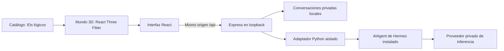

# Arquitectura local

## Módulos
- `src/world`: geometría, selección, cámaras, movimiento y colisiones exteriores sencillas. No conoce credenciales ni llama a modelos.
- `src/ui`: conversación y estados visibles. Solo una respuesta efectiva se etiqueta como recibida de Hermes.
- `src/data`: catálogo y vínculos por identificadores, sin rutas del disco.
- `src/api`: contrato HTTP de AgoraOne, independiente de los endpoints de Hermes.
- `server/app.ts`: validación, origen/host/CSRF, identidad local y autorización por conversación.
- `server/conversations.ts`: persistencia atómica JSON con permisos 0600, directorio privado.
- `server/document-extraction.ts` y `extract-document.mjs`: validación y extracción de PDF/DOCX en proceso limitado sin credenciales; persisten solo texto mediante `private-library.ts`.
- `server/hermes-location.ts`, `hermes-catalog.ts`, `hermes-safe-read.ts`, `hermes-database.ts`: detección local y catálogo de solo lectura, independiente de la ejecución AIAgent. Contrato en shared/hermes-catalog.ts, proyección visual en src/data/city.ts y ficha en src/ui/hermes-panel.tsx.
- `server/profile-editor.ts` y `hermes_profile_write.py`: única escritura en perfiles de Hermes, limitada a SOUL.md, MEMORY.md y USER.md desde la ficha, con confirmación, copia previa, control de revisión y el bloqueo de memoria de Hermes (docs/edicion-perfiles.md).
- `server/hermes-adapter.ts`, `hermes-worker.ts` y `hermes_bridge.py`: procesos exclusivos por conversación reutilizables durante cinco minutos, agente nuevo por turno, streaming, configuración, timeout y capacidades. Ver latencia-chat.md.
- `server/profile-context.ts` y `hermes_identity.py`: snapshot autorizado de identidad por turno y construcción del prompt; sin lectura de rutas desde el proceso del modelo. Los perfiles conversan en hogares separados por sesión bajo .agora/hermes-conversations.

## Identidades
Personaje Luma → agente lógico `luma` → contexto `library-lobby`. Perfil Hermes y bot: `null`; no se mapean a los del usuario. Cada conversación recibe UUID propio y otro ID de sesión Hermes generado en backend. El historial que llega al modelo procede del almacenamiento del servidor, nunca del cliente.

Perfiles detectados: conversación ligada a profileId, agentId y contexto profile-chat:<profileId>, además del propietario. Cada envío revalida identidad y memoria del perfil. Se usa el proveedor de AgoraOne y cero herramientas; las sesiones y memorias originales de Desktop no se escriben. El cliente no puede sustituir perfil, historia o capacidades de una conversación existente.

La identidad de usuario local es un token aleatorio HttpOnly, SameSite=Strict; se almacena su hash como propietario. La cookie equivale a la credencial local del navegador, no a una cuenta de usuario. El backend rechaza IDs ajenos. El cliente conserva únicamente el ID de conversación en localStorage. La cookie dura 30 días; perderla deja el historial inaccesible desde esa identidad. Los archivos permanecen locales.

Las importaciones usan la misma identidad. `server/private-library.ts` guarda copias en `.agora/library/<owner>`, valida datos y permisos en lectura y antes de invocar Hermes. El selector envía nombre y bytes, nunca una ruta física. Los ejemplos son compartidos, las copias importadas privadas. Ver docs/importacion.md.

## Límites de confianza
Vite escucha en `127.0.0.1:5173`, Express en `127.0.0.1:4317`; ambos puertos fijos. Backend valida Host y Origin, exige token CSRF en mutaciones y no permite que el cliente elija herramientas, modelo, usuario o sesión Hermes. Sin CORS abierto. Credenciales nunca tienen prefijo VITE_. No se sirven `.env` ni `.agora` desde Express; solo `dist`.

Backend y navegador se ejecutan localmente; la inferencia viaja al proveedor privado elegido. El movimiento no produce llamadas de inferencia. El build y las dependencias se descargan durante instalación, pero la escena no necesita fuentes ni modelos 3D remotos.

## Evolución de recursos
Los edificios representan IDs como `library-lobby`. El recurso `library-test` tiene registro cerrado en `server/library.ts`, raíz resources/library-test, solo lectura, validación de realpath, enlaces, tamaño y formato. El backend adjunta el documento seleccionado a cada petición Hermes; el agente conserva cero herramientas. Para evolucionar a búsqueda autónoma, diseñar herramientas específicas por ejecución; no activar terminal genérico ni acceso global al disco.

Vista general, primera persona exterior y biblioteca interior están disponibles. Los otros interiores, física Rapier, avatares complejos y WebXR se incorporarán por hitos; capacidades de Quest y Vision Pro se comprobarán independientemente. Las etiquetas DOM tienen ciclo de vida propio en WorldLabel para evitar conflictos al cambiar escenas de R3F.

La ciudad ya no usa los cinco agentes ficticios como inventario: recibe perfiles y espacios de /api/hermes/catalog. Un personaje representa la identidad de un perfil, no una sesión activa; la ficha explica su vínculo con Bots de Desktop. Luma se conserva aparte como función de AgoraOne. Ver docs/catalogo-hermes.md para capacidades, fuentes y límites de portabilidad.

## Lecturas en segundo plano y carga del frontend
Las lecturas síncronas pesadas (actividad de Hermes con `node:sqlite` y notas de Obsidian) se ejecutan en un `worker_threads` de larga vida (`server/read-worker.ts`), así que el servidor responde a otras peticiones mientras tanto; el worker conserva sus cachés. El cliente del hilo principal (`server/background-reads.ts`) admite como máximo 8 tareas en espera (la novena se rechaza al momento) y da 20 s a cada tarea desde que empieza a ejecutarse, no desde que se encola; si una tarea se pasa, sustituye el worker y solo falla lo que tenía ese worker. Las rutas reciben del catálogo las carpetas de cada perfil; el cliente nunca envía rutas.

En el navegador, la escena 3D (`src/world/city.tsx` con three.js, React Three Fiber y el posprocesado) se carga con `React.lazy` en un trozo propio de unos 1,4 MB; la interfaz (unos 270 KB) se puede usar antes. Si ese trozo no se descarga, solo la escena muestra un aviso y el directorio y el chat siguen disponibles.
